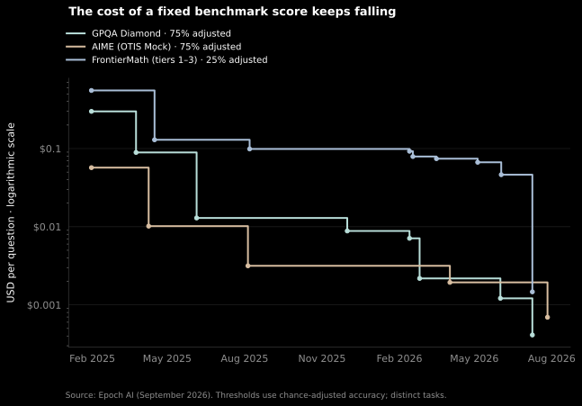
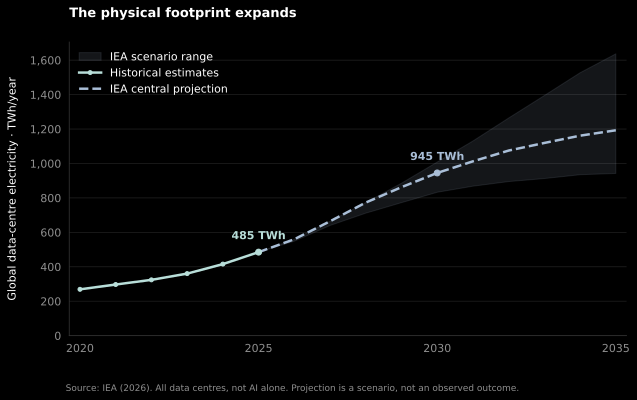
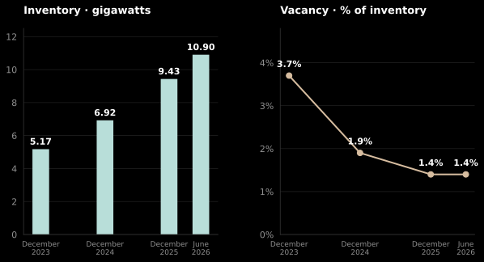
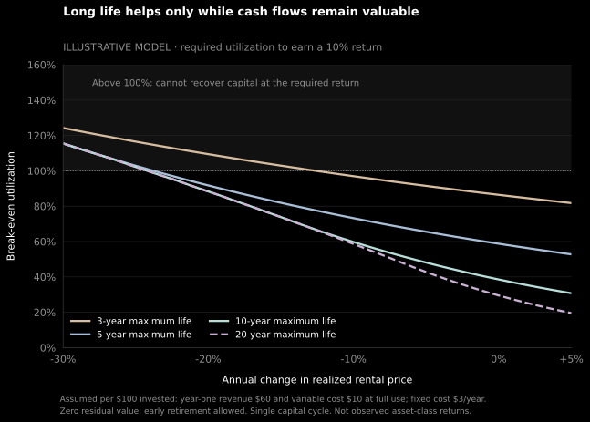

fr8 is bullish on the future of compute. In a future where intelligence is abundant and cheap, the durable advantage is owning the means of production.
{: .thesis }

## 1. Intelligence gets cheaper

Epoch's September 2026 analysis estimates that this cost fell roughly **13-fold per year** across its selected benchmarks since 2023.

**Figure 1.** Cost in United States dollars per question at fixed, chance-adjusted benchmark accuracy. GPQA is a graduate-level, Google-proof question-answering benchmark. AIME means American Invitational Mathematics Examination; these mock questions come from Olympiad Training for Individual Study (OTIS). [Source](https://epoch.ai/publications/the-plunging-price-of-thought)
{: .caption }

## 2. Capacity is growing

The International Energy Agency (IEA) estimates that global data-centre electricity consumption will go from **485 terawatt-hours (TWh) in 2025** to **945 TWh in 2030**. McKinsey projects that artificial intelligence (AI) workloads will account for about **70% of global data-centre capacity demand by 2030**. [Source](https://www.mckinsey.com/mgi/our-research/colocation-data-centers-the-infrastructure-race-behind-ai)

**Figure 2.** All data centres, including non-AI workloads. Dashed values are projections; the shaded scenario range is not a confidence interval. Electricity measures the physical footprint, not useful computation. [Source chart](https://www.iea.org/data-and-statistics/charts/electricity-consumption-by-data-centres-2020-2035) · [Data and method](https://github.com/kiankyars/fr8/blob/main/README.md#figure-2)
{: .caption }

## 3. Jevon's paradox

In the eight primary North American data-centre markets tracked by commercial-property firm CBRE (Coldwell Banker Richard Ellis), reported inventory rose from **5.17 gigawatts (GW) at the end of 2023 to 10.90 GW in mid-2026**, while vacancy fell from **3.7% to 1.4%**.

**Figure 3.** Inventory and vacancy describe leasable data-centre capacity. Vacancy is not graphics processing unit (GPU) utilization or electrical load. Geography and the ability to deliver power matter; these eight markets are not the global market. [Source](https://www.cbre.com/insights/books/north-america-data-center-trends-h1-2026) · [Data and method](https://github.com/kiankyars/fr8/blob/main/README.md#figure-3)
{: .caption }

## 4. Compute may depreciate more slowly

Older GPUs are retaining earning power. CoreWeave renewed A100 capacity for **three years, extending into 2029**, at pricing comparable to typical one-year contracts. NVIDIA introduced this GPU generation in **2020**. CoreWeave also reported renewing a contract for **more than 10,000 H100s within 5% of its original price**. [H100 source](https://s205.q4cdn.com/133937190/files/doc_financials/2025/q3/CORRECTED-TRANSCRIPT_-CoreWeave-Inc-CRWV-US-Q3-2025-Earnings-Call-10-November-2025-5_00-PM-ET.pdf)

Better software could make the same hardware more valuable. [Dwarkesh Patel argues](https://www.dwarkesh.com/p/why-compute-might-get-10x-more-expensive) that, if an H100-equivalent could run a human-level software engineer, its annual rental value could exceed **$250,000—about 15 times the spot price at the time**. That is a conditional scenario; the renewals are observed evidence of durable rental demand, rather than a measured rate of depreciation in chip resale values.

**Figure 4.** The 2029 contract endpoint is nine calendar years after the A100's 2020 introduction. This is the generation's age, not the operating age of each chip; exact contract dates were not disclosed. [NVIDIA launch](https://nvidianews.nvidia.com/news/nvidias-new-ampere-data-center-gpu-in-full-production) · [CoreWeave, slide 10](https://www.sec.gov/Archives/edgar/data/1769628/000176962826000429/crwv2026convertpresentat.htm) · [Data and method](https://github.com/kiankyars/fr8/blob/main/README.md#figure-4)
{: .caption }

The strongest version of the thesis is ownership of capacity that stays useful and costly to replicate: deliverable power, suitable sites, and infrastructure with durable customer demand. GPUs, buildings, grid access, and generation have different replacement cycles and economics. Growing demand supports investigating them; it does not establish attractive returns at any purchase price.

The thesis weakens if efficiency overtakes usage growth, new supply removes scarcity, or falling prices and replacement spending absorb the owner's cash flow. The remaining work is to establish which assets retain an advantage under those conditions.
